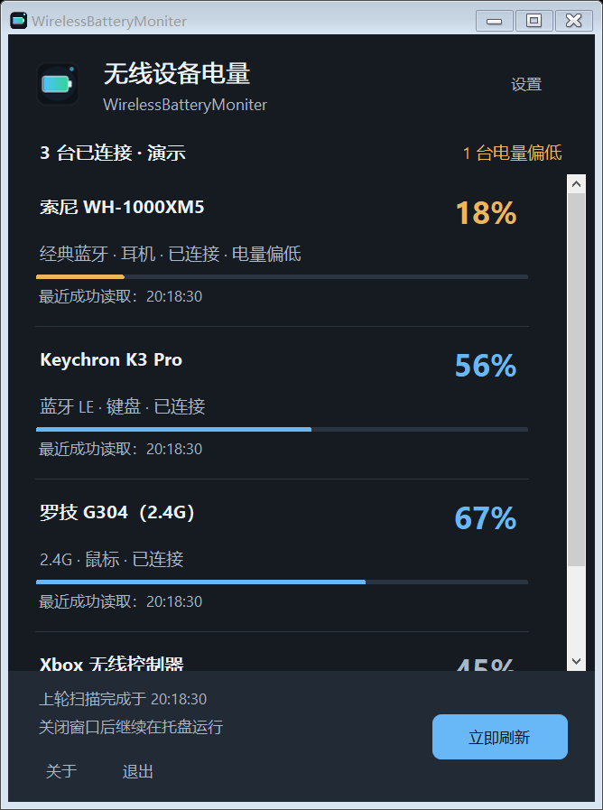

<!-- 最新发布/运行规则优先于下方历史功能说明。 -->
# WirelessBatteryMoniter

Windows 10/11 无线设备电量工具，当前版本 **1.2.3**（2026-11-20）。

一个托盘图标显示已连接设备数量及最低电量。主窗口关闭后继续后台运行，真正退出使用托盘菜单或主窗口“退出”按钮。默认每 10 秒扫描一次，扫描未结束时不会重入。



## 1.2.2 鼠标兼容性修复

新增 XINMENG `3151:5045` 接收器 Feature Report 电量查询。该接口没有 Output Report，旧版筛选时会忽略。[验证记录](docs/validation/reports/validation-xinmeng.md)

## 固定安装与启动

发布包是安装介质，运行 `Start.cmd` 完成安装/升级并启动，或 `Install.cmd` 仅安装。唯一运行文件是 `%LOCALAPPDATA%\Programs\WirelessBatteryMoniter\WirelessBatteryMoniterTray.exe`；日常使用桌面快捷方式。
## 目录导航

```text
src/                    程序源码与编译所需资源
tools/                  编译、验证、图标制作工具
packaging/              安装和启动模板；manual/ 为手动应急工具
design/assets/          图标设计原稿
docs/
  user/                 随发布包分发的用户说明
  development/          开发与发布流程
  history/              对话及历史修改资料
  validation/reports/   已归档的验证报告
  validation/results/   已归档的原始测试文本
  images/               文档截图
artifacts/              本地产物，不提交、不打包
  build/                开发编译输出和中间文件
  tests/                当前测试输出
  temp/                 构建临时文件
  archive/              迁移前的历史产物与临时资料
dist/v1.2.3/            当前可交付文件与压缩包
.tools/                 本地工具链和依赖缓存
```

文档入口：[资料索引](docs/README.md)。

## 当前修订：扫描、缓存与错误提示

| 场景 | 当前行为 |
|---|---|
| 蓝牙或 HID 通道超时/异常 | 保留成功通道的新结果，失败通道沿用上次读数并标记缓存；仍需等待取消清理结束后发布本轮结果。 |
| 整轮扫描超过 35 秒 | 请求取消，不保证驱动能在 35 秒内完成清理。程序退出取消不会发布新结果。 |
| 2.4G/HID 短暂读取失败 | 前两轮保留连接状态并标记缓存；连续 3 轮完整扫描未读到才判定断开。成功读取清零计数，整轮取消不计数。 |
| 蓝牙暂时没有电量值 | 有历史读数时回退缓存并保留原读取时间；无历史读数时不生成虚假电量。经典蓝牙也支持此回退。 |
| 单个蓝牙设备异常 | 保留该设备可用缓存，继续处理其他设备；通道枚举失败时保留该通道缓存。 |
| 部分设备读取成功 | 成功结果继续更新，同时显示失败原因；正常设备的新鲜低电量读数仍可提醒。 |
| 后续读取恢复 | 新读数替换缓存；无新异常时清除旧警告。 |

主窗口中的“读取异常 · 点击查看详情”可点击打开完整消息，也可悬停查看。处于连接待确认状态的旧数据会显示“连接待确认 · 缓存读数”，托盘设备行标注“缓存”。

防抖当前只针对 2.4G/HID。真实拔出设备也需要连续三轮完整扫描才显示断开，实际延迟取决于刷新间隔和扫描耗时。缓冲期间不重新触发低电量提醒；确认断开后再次连接可重新提醒。

蓝牙和 HID 的历史读数仅保留在本次程序运行内，重启后清空。蓝牙缓存回退不重置原时间。BLE 与经典蓝牙打开设备各有 5 秒取消超时，BLE 电量查询另有 5 秒取消超时；BLE 遍历达到时间预算后会提示并尝试保留未处理设备的缓存。

## 悬停提示

第一行只含程序名称和已连接设备数量，不显示最低电量。其后每台设备一行，保留连接方式、设备类型、名称和电量。设备类型根据已知名称识别，未知型号显示“设备”；断开设备遵循“显示未连接设备”设置并标明状态。

纯文字提示框保留完整名称、设备类型和电量，摆脱原生 127 字符限制；主页面与托盘共用类型判定规则。

旧版正在运行时可使用 `build.ps1 -FrameworkCompiler -VersionedOutput` 生成独立目录 `dist/v1.2.3/`；运行发布目录中的 Start.cmd 安装或升级。

## 1.2.0 历史修改

以下修改记录中的读取失败、缓存和提醒行为以本文“当前修订”说明为准。

- HID 设备分组保留 VID/PID 和接收器实例，只合并同一接口的 collection，避免不同接收器混在一起。
- 罗技接收器遍历槽位 1–6，不再找到第一台设备就停止。
- 按稳定设备 ID 去重，保留两台同名设备。蓝牙双模设备在取得相同蓝牙地址时合并；不会仅凭名称跨蓝牙/2.4G 猜测身份。
- HID 异步 I/O 固定缓冲区和 OVERLAPPED 地址，取消后等待完成再释放，并传播扫描取消信号。
- HID 断开或读取失败时显示本次运行中的最后读数及原时间，标记为未连接/缓存；重启后不保留硬件缓存。
- 电量提醒只对新鲜且已连接的读数触发。恢复到“阈值 + 5”以上、断开后重连或重新开启通知时重新布防。
- 蓝牙显式请求电量/连接属性；BLE 单设备超时后继续尝试缓存回退；经典蓝牙不再默认认定已连接。
- 本机托盘故障根因：exe 继承低完整性标签，启动后的低完整性进程无法向普通 Explorer 注册图标。已仅将本项目发布 exe 调整为中完整性，未修改工作区或系统目录的标签。
- 托盘探针接受非负 HRESULT 配合有效矩形，避免把返回 `S_FALSE` 的有效矩形误判为失败。
- 托盘诊断记录 HRESULT、窗口句柄、图标 ID、矩形和框架内部注册状态。启动失败最多重试三次，之后打开主窗口；每 30 秒继续检查。不会自动重置系统缓存。
- 修复退出时定时器及句柄释放，以及扫描未结束就清空 Provider 的竞态。
- `--minimized` 优先于保存的显示偏好；开机启动项明确带此参数。
- 安装快捷方式直接指向程序；保留原安装位置，迁移已有开机启动项。

## 支持范围与限制

- 已实测：本机罗技 `046D:C54D` 接收器、PRO X2 SUPERSTRIKE。
- 已实现但需真实设备验证：BLE 标准电池服务、经典蓝牙属性读取、其他罗技型号、ATK/VXE/CompX 协议、多接收器和单接收器多设备。
- 部分协议只提供电压或粗略档位，显示百分比可能是估算，不代表设备原生精确百分比。
- 缺少电量协议的设备不会自动变得可读取。暂不支持耳机左右耳/充电盒分别显示。
- 当前按定时轮询读取，扫描耗时可能超过设定间隔，不是连续推送的实时遥测。
- 某些异常驱动取消 I/O 的完成时间无法由应用保证；为防止内存损坏，代码会等待内核完成后释放资源。
- UI 保留固定布局和 Windows 位图缩放；高 DPI 清晰度、跨屏布局仍需验证。

## 发布与 SmartScreen

当前 exe 未签名，Windows 可能显示未知发布者提示。正式发布仍需评估签名或商店分发。

## 项目资料

- [项目目录重构验证](docs/validation/reports/validation-layout.md)：34 个源码及资源文件保持不变，新目录下开发/发布构建、自检与诊断通过。
- [设置默认值与文档清理](docs/validation/reports/validation-settings-defaults.md)：最新修订，72 项自检通过。
- [蓝牙缓存与错误提示验证](docs/validation/reports/validation-bluetooth-cache.md)：该阶段 69 项自检通过。
- [HID 防抖验证](docs/validation/reports/validation-hid-debounce.md)：该阶段 61 项自检通过。
- [超时结果保留验证](docs/validation/reports/validation-timeout-results.md)：该阶段 53 项自检通过。
- [1.2.1 悬停提示验证](docs/validation/reports/validation-v1.2.1.md)：该阶段 44 项自检及托盘检查。
- [1.2.0 历史验证](docs/validation/reports/validation-v1.2.0.md)：早期修复和实机验证范围。
- `src/WirelessBatteryMoniter/`：Models、Services、App、UI、Interop。
- `packaging/`：安装及历史手动修复脚本。
- MIT，见 [LICENSE](LICENSE)。
