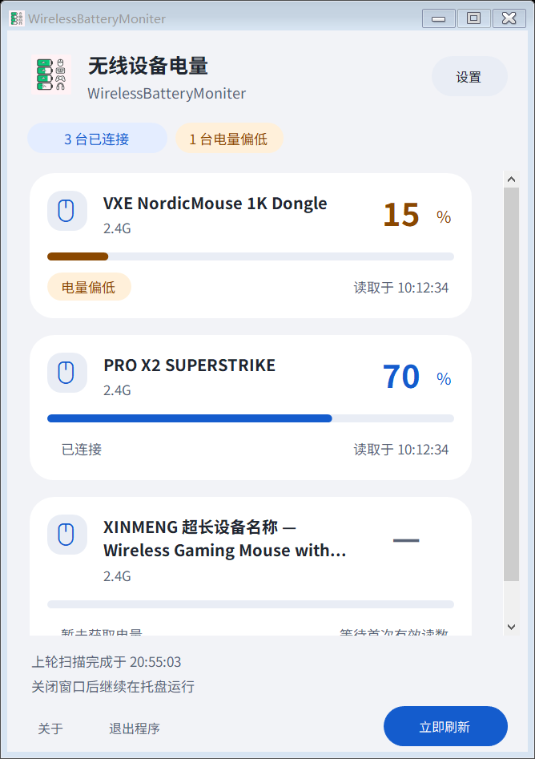

<!-- 最新发布/运行规则优先于下方历史功能说明。 -->
# WirelessBatteryMoniter

## 程序简介

Windows 10/11 无线设备电量工具，当前版本 **1.4.1**（2026-11-26）。

[下载最新版本](https://github.com/Z5W/WirelessBatteryMonitor/releases/latest) · [用户说明](docs/user/README.md) · [更新日志](CHANGELOG.md)

一个托盘图标显示已连接设备数量及最低电量。主窗口关闭后继续后台运行，真正退出使用托盘菜单或主窗口“退出”按钮。默认每个通道完成后间隔 10 秒查询；蓝牙与 HID 独立调度，同一通道查询未结束时不会重入。



## 固定安装与启动

当前 exe 未签名，Windows 可能显示未知发布者提示。正式发布仍需评估签名或商店分发。

发布包是安装介质，运行 `Start.cmd` 完成安装/升级并启动，或 `Install.cmd` 仅安装。唯一运行文件是 `%LOCALAPPDATA%\Programs\WirelessBatteryMoniter\WirelessBatteryMoniterTray.exe`；日常使用桌面快捷方式。

升级前请从托盘菜单或主窗口点击“退出”；关闭窗口只会隐藏程序。随后解压完整发布包，运行 `Start.cmd`。

开发者可使用 `build.ps1 -FrameworkCompiler -VersionedOutput` 生成独立目录 `dist/v1.4.1/`；构建时可以保留旧程序运行，安装升级前仍须退出。详见 [开发与发布流程](docs/development/WORKFLOW.md)。

## 支持范围与限制

- 历史实机验证：罗技 `046D:C54D` 接收器、PRO X2 SUPERSTRIKE；另有 PRO X 2、PRO X2 SUPERSTRIKE 与 XINMENG `3151:5045` 接收器鼠标同时读取的[验证记录](docs/validation/reports/validation-xinmeng.md)。不代表本版本已重新验证所有设备。
- 已实现但需真实设备验证：BLE 标准电池服务、经典蓝牙属性读取、其他罗技型号、ATK/VXE/CompX 协议、多接收器和单接收器多设备。
- 部分协议只提供电压或粗略档位，显示百分比可能是估算，不代表设备原生精确百分比。
- 缺少电量协议的设备不会自动变得可读取。暂不支持耳机左右耳/充电盒分别显示。
- 当前按定时轮询读取，扫描耗时可能超过设定间隔，并在设备插拔或系统唤醒后触发刷新，不是连续推送的实时遥测。
- 某些异常驱动取消 I/O 的完成时间无法由应用保证；为防止内存损坏，代码会等待内核完成后释放资源。
- UI 使用 WinForms，设备卡片随窗口宽度切换单列/双列；高 DPI 清晰度、跨屏布局仍需真实多显示器验证。

逐设备设置、连接未知/缓存、电量精度和充电提醒的详细行为见 [用户说明](docs/user/README.md)。

## 目录导航

```text
src/                    程序源码与编译所需资源
tools/                  编译、验证、图标制作工具
packaging/              安装和启动模板；manual/ 为手动应急工具
design/assets/          图标设计原稿
docs/
  user/                 随发布包分发的用户说明
  development/          开发与发布流程
  history/              本地对话及历史修改资料，不公开
  validation/reports/   已归档的验证报告
  validation/results/   本地原始测试文本，不公开
  images/               文档截图
artifacts/              本地产物，不提交、不打包
  build/                开发编译输出和中间文件
  tests/                当前测试输出
  temp/                 构建临时文件
  archive/              迁移前的历史产物与临时资料
dist/v1.4.1/            当前可交付文件与压缩包
.tools/                 本地工具链和依赖缓存
```

文档入口：[资料索引](docs/README.md)。

## 更新记录

### 1.4.1 更新

- 更新程序主图标，统一主界面和各窗口的内嵌图标资源；动态电量托盘图标保持原有样式。
- 修复桌面快捷方式、安装后启动及 `run.ps1 -Open` 的窗口显示行为。

### 1.4.0 更新

- 逐设备别名、隐藏/恢复、独立提醒阈值及通知开关。
- 蓝牙与 HID 独立调度、失败退避及慢驱动隔离；插拔和唤醒合并刷新。
- 充电状态与电量来源/精度说明，估算值显示“约”；未知连接不再被推断为断开。
- 充电、缓存及休眠状态参与提醒判断，未知状态不自行推断。

### 1.3.0 更新

- 浅色圆角设备卡片、自适应排列、设备详情及统一内置字体。
- 缓存读数保留显示，连接待确认设备不再计入当前连接数、最低电量和低电量统计。
- 设置保存失败显示原因并支持重试；修改提醒阈值立即重绘托盘。
- 刷新异常保留旧读数与原时间，显示错误详情；成功读取后恢复。

完整记录见 [更新日志](CHANGELOG.md)。

### 1.2.2 鼠标兼容性修复

新增 XINMENG `3151:5045` 接收器 Feature Report 电量查询。该接口没有 Output Report，旧版筛选时会忽略。[验证记录](docs/validation/reports/validation-xinmeng.md)

### 1.2.0 历史修改

以下为 1.2.0 阶段的历史记录；当前读取失败、缓存和提醒行为以 [用户说明](docs/user/README.md) 为准。自 1.4.0 起，HID 缺少读数显示连接未知，不再根据连续未读到推断断开。

- HID 设备分组保留 VID/PID 和接收器实例，只合并同一接口的 collection，避免不同接收器混在一起。
- 罗技接收器遍历槽位 1–6，不再找到第一台设备就停止。
- 按稳定设备 ID 去重，保留两台同名设备。蓝牙双模设备在取得相同蓝牙地址时合并；不会仅凭名称跨蓝牙/2.4G 猜测身份。
- HID 异步 I/O 固定缓冲区和 OVERLAPPED 地址，取消后等待完成再释放，并传播扫描取消信号。
- HID 断开或读取失败时显示本次运行中的最后读数及原时间，标记为未连接/缓存；重启后不保留硬件缓存。
- 电量提醒只对新鲜且已连接的读数触发。恢复到“阈值 + 5”以上、断开后重连或重新开启通知时重新布防。
- 蓝牙显式请求电量/连接属性；BLE 单设备超时后继续尝试缓存回退；经典蓝牙不再默认认定已连接。
- 本机托盘故障根因：exe 继承低完整性标签，启动后的低完整性进程无法向普通 Explorer 注册图标。已仅将本项目发布 exe 调整为中完整性，未修改工作区或系统目录的标签。
- 托盘探针接受非负 HRESULT 配合有效矩形，避免把返回 `S_FALSE` 的有效矩形误判为失败。
- 托盘诊断记录 HRESULT、窗口句柄、图标 ID、矩形和框架内部注册状态。启动失败最多重试三次，之后打开主窗口；每 30 秒继续检查。不会自动重置系统缓存。
- 修复退出时定时器及句柄释放，以及扫描未结束就清空 Provider 的竞态。
- `--minimized` 优先于保存的显示偏好；开机启动项明确带此参数。
- 安装快捷方式直接指向程序；保留原安装位置，迁移已有开机启动项。

## 项目资料

- [1.4.1 发布验证](docs/validation/reports/validation-v1.4.1.md)：168 项逻辑自检、74 项界面检查、8 项发布事务检查及 5 项安装回归通过。
- [1.4.0 发布验证](docs/validation/reports/validation-v1.4.0.md)：168 项逻辑自检、68 项界面检查、8 项发布事务检查及 5 项安装回归通过；实机验证范围与限制见报告。
- 以下报告为各历史阶段记录，不代表当前版本重新执行的结果。
- [项目目录重构验证](docs/validation/reports/validation-layout.md)：34 个源码及资源文件保持不变，新目录下开发/发布构建、自检与诊断通过。
- [设置默认值与文档清理](docs/validation/reports/validation-settings-defaults.md)：该阶段 72 项自检通过。
- [蓝牙缓存与错误提示验证](docs/validation/reports/validation-bluetooth-cache.md)：该阶段 69 项自检通过。
- [HID 防抖验证](docs/validation/reports/validation-hid-debounce.md)：该阶段 61 项自检通过。
- [超时结果保留验证](docs/validation/reports/validation-timeout-results.md)：该阶段 53 项自检通过。
- [1.2.1 悬停提示验证](docs/validation/reports/validation-v1.2.1.md)：该阶段 44 项自检及托盘检查。
- [1.2.0 历史验证](docs/validation/reports/validation-v1.2.0.md)：早期修复和实机验证范围。
- `src/WirelessBatteryMoniter/`：Models、Services、App、UI、Interop。
- `packaging/`：安装及历史手动修复脚本。
- 程序使用 MIT 许可；内置字体采用 SIL OFL 1.1，均见 [LICENSE](LICENSE)。
